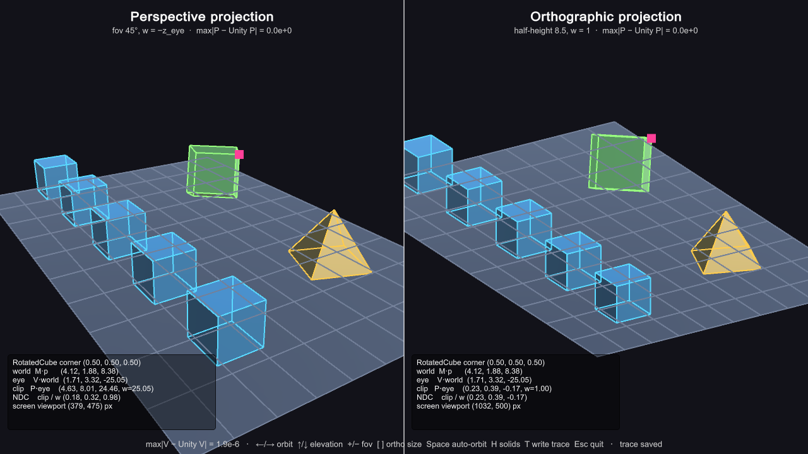

# Lab 10 — 3D Viewing Pipeline (Projection and Viewport Mapping)

`viewing_pipeline.cpp` carries a wireframe 3D scene through every stage of
the viewing pipeline explicitly on the CPU, using 4×4 homogeneous matrices
(column vectors, `p' = M · p`):

```
object ──M──▶ world ──V──▶ eye ──P──▶ clip ──÷w──▶ NDC ──viewport──▶ screen
```

| Stage | What happens |
|---|---|
| **Modeling** `M` | Scale / rotate / translate each object into the world |
| **Viewing** `V` | `lookAt(eye, target, up)` builds the camera's `u, v, n` axes and moves the eye to the origin |
| **Clipping** | Edges are clipped against the near plane in eye space, so nothing behind the camera is projected |
| **Projection** `P` | Perspective (fov 45°, `w = −z_eye`) or orthographic (`w = 1`) |
| **Perspective divide** | `clip.xyz / clip.w` gives normalized device coordinates in `[−1, 1]` |
| **Viewport mapping** | `x_s = x_v + (x_ndc + 1)/2 · width`, `y_s = y_v + (y_ndc + 1)/2 · height` |

The same scene (a ground grid, a row of identical cubes receding into the
distance, a pyramid and a rotated cube) is shown through two 460×460
viewports on one window:

- **Left — perspective projection:** the identical cubes shrink with distance
  and parallel grid lines converge.
- **Right — orthographic projection:** every cube is the same size and
  parallel lines stay parallel.

OpenGL only draws the final 2D pixel-space segments (each view is scissored
to its viewport rectangle) — it never receives a 3D coordinate. After the
screenshot is taken, the camera slowly orbits the scene.

The program also writes `screenshots/pipeline_trace.txt`: the `M`, `V` and
both `P` matrices, plus one cube corner traced through object → world → eye
→ clip → NDC → screen for each projection.

## Build and run

```sh
cmake -S . -B build
cmake --build build
./build/viewing_pipeline
```

The program automatically saves a screenshot
(`screenshots/viewing_pipeline.ppm`) and the pipeline trace a few frames after
launch, then keeps the window open — press <kbd>Esc</kbd> or close it to
exit. Convert to PNG with:

```sh
cd screenshots
sips -s format png viewing_pipeline.ppm --out viewing_pipeline.png
```

The final screenshot is `screenshots/viewing_pipeline.png`.

---

## Unity version

This folder is also a Unity 6 project (`Assets/`, `Packages/`,
`ProjectSettings/`) that does the same viewing pipeline by hand inside Unity.
The C++/OpenGL files above are untouched.



`Assets/Scripts/ViewingPipeline.cs` takes every wireframe edge through
**object → M → world → V → eye → near-plane clip → P → clip → ÷w → NDC →
viewport → screen** on the CPU each frame. Only the final 2D pixel coordinates
go to the GPU, drawn with `GL` in `OnPostRender`. `Assets/Scripts/Mat.cs`
builds every matrix by hand: `Translate`, `RotateX/Y`, `Scale`,
`LookAt (u, v, n)`, `Perspective`, `Orthographic` and the `Viewport` mapping.
None of them use Unity's matrix helpers.

Unity also renders the same objects as solids, through two ordinary cameras
set up with the same eye, fov, near/far planes and viewport rectangles. That
gives two checks on the hand-built pipeline:

1. **Visual:** the hand-projected wireframe sits exactly on Unity's own render
   in both views.
2. **Numeric:** the HUD and `screenshots/pipeline_trace_unity.txt` report the
   largest difference between the hand-built matrices and Unity's
   (`M` vs `transform.localToWorldMatrix`, `V` vs `camera.worldToCameraMatrix`,
   `P` vs `camera.projectionMatrix`). Every difference is ≤ 2·10⁻⁶. The traced
   cube corner also lands on the same pixel that `Camera.WorldToScreenPoint`
   gives.

The left view is **perspective**: the identical cubes shrink with distance and
parallel grid lines converge. The right view is **orthographic**: the cubes
keep the same size and parallel lines stay parallel. The pink square marks the
traced vertex, and each view's panel shows that vertex's coordinates at every
stage.

**Controls:** ←/→ orbit, ↑/↓ elevation, `+`/`−` field of view, `[`/`]`
orthographic size, <kbd>Space</kbd> auto-orbit on/off (it starts after 3 s),
<kbd>H</kbd> show/hide the solids, <kbd>T</kbd> rewrite the trace file,
<kbd>Esc</kbd> quit.

Files:

- `Assets/Scripts/PipelineObject.cs`: modeling parameters (T, R, S), the
  hand-built model matrix `M = T·Ry·Rx·S`, and object-space wireframe geometry
  for the cube, pyramid and grid
- `Assets/Shaders/Line.shader`: flat-colour, always-on-top shader for the 2D
  segments
- `Assets/Editor/Lab10SceneBuilder.cs`: builds the scene from code (menu:
  **Lab10 → Build Sample Scene**)
- `Assets/Editor/Lab10Builder.cs`: builds `UnityBuild/Lab10.app`

### Opening in the Editor

Open Unity Hub, choose **Projects → Add**, and select this `LAB10` folder.
Open `Assets/Scenes/Lab10Scene.unity` and press **Play**. Use a wide Game view
(for example 16:9) so the two viewports have room.

### Rebuilding and screenshotting from the terminal

```sh
UNITY_BIN="/Applications/Unity/Hub/Editor/6000.6.0f1/Unity.app/Contents/MacOS/Unity"
LAB10_PATH="/Users/aaditpani/Desktop/SEM7/CGVR/Lab01/LAB10"

"$UNITY_BIN" -batchmode -quit -projectPath "$LAB10_PATH" -executeMethod Lab10SceneBuilder.BuildScene
"$UNITY_BIN" -batchmode -quit -projectPath "$LAB10_PATH" -executeMethod Lab10Builder.BuildStandalonePlayer

"$LAB10_PATH/UnityBuild/Lab10.app/Contents/MacOS/LAB10" -screen-width 1280 -screen-height 720 -screen-fullscreen 0 &
PID=$!; sleep 6; kill $PID

OUT="$HOME/Library/Application Support/DefaultCompany/LAB10"
cp "$OUT/lab10_scene.png"     "$LAB10_PATH/screenshots/lab10_unity_scene.png"
cp "$OUT/pipeline_trace.txt"  "$LAB10_PATH/screenshots/pipeline_trace_unity.txt"
```
