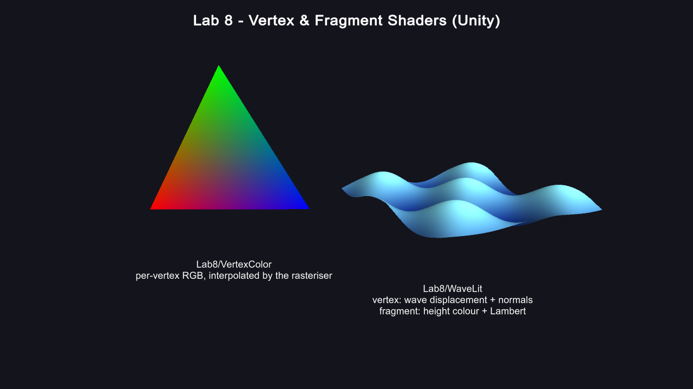

# Lab 8 — Vertex and Fragment Shaders

`shader_triangle.cpp` is the Lab 8 OpenGL program. It creates an OpenGL 3.3
core window, compiles a vertex shader and a fragment shader, uploads a
position-and-color triangle to a VBO, and renders it through a VAO. The vertex
shader forwards per-vertex RGB values; the fragment shader receives the
interpolated color and writes it to the framebuffer.

`shader_preview.cpp` produces the matching reference render without a display
server. It is used to create the checked-in screenshot in headless execution
environments.

## Build and run

```sh
cmake -S . -B build
cmake --build build

# Interactive OpenGL application (press Esc to close):
./build/shader_triangle

# Deterministic screenshot generation:
mkdir -p screenshots
./build/shader_preview screenshots/vertex_fragment_shader.ppm
sips -s format png screenshots/vertex_fragment_shader.ppm \
  --out screenshots/vertex_fragment_shader.png
```

The screenshot shows the same red, green, and blue vertex colors interpolated
across the triangle by the fragment-shader stage.

---

## Unity version

This folder is also a Unity 6 project (`Assets/`, `Packages/`,
`ProjectSettings/`) that does the same lab with Unity shaders. The OpenGL
files above are untouched; Unity ignores them.



- `Assets/Shaders/VertexColor.shader`: the Unity counterpart of
  `shader_triangle.cpp`'s GLSL pair. The vertex stage transforms to clip space
  and passes on the per-vertex colour, and the fragment stage outputs the
  interpolated colour.
- `Assets/Shaders/WaveLit.shader`: a second pair where both stages do real
  work. The **vertex shader** moves a flat grid into a travelling wave
  `y = A·sin(kx + t)·cos(kz + 0.7t)` and computes the surface normal from the
  partial derivatives. The **fragment shader** colours by height and applies
  Lambert diffuse lighting from the scene's directional light.
- `Assets/Scripts/ColoredTriangle.cs`: builds the RGB triangle as a `Mesh`
  with a colour attribute, which is Unity's equivalent of the VAO/VBO.
- `Assets/Scripts/GridMesh.cs`: the flat 80×80 grid that the wave shader
  displaces on the GPU.
- `Assets/Scripts/Spin.cs`, `Labels.cs` and `ScreenshotCapture.cs`: rock the
  triangle, draw the captions, and take a screenshot automatically after 2 s.
- `Assets/Editor/Lab8SceneBuilder.cs`: builds the whole scene from code and
  saves it as `Assets/Scenes/Lab8Scene.unity`. Use the menu
  **Lab8 → Build Sample Scene** to rebuild it.
- `Assets/Editor/Lab8Builder.cs`: builds a standalone macOS player into
  `UnityBuild/Lab8.app`. It uses `UnityBuild/`, not `Build/`, because macOS's
  case-insensitive filesystem would merge `Build/` with the CMake `build/`
  folder.

### Opening in the Editor

Open Unity Hub, choose **Projects → Add**, and select this `LAB8` folder. Open
`Assets/Scenes/Lab8Scene.unity` and press **Play**.

### Rebuilding and screenshotting from the terminal

```sh
UNITY_BIN="/Applications/Unity/Hub/Editor/6000.6.0f1/Unity.app/Contents/MacOS/Unity"
LAB8_PATH="/Users/aaditpani/Desktop/SEM7/CGVR/Lab01/LAB8"

"$UNITY_BIN" -batchmode -quit -projectPath "$LAB8_PATH" -executeMethod Lab8SceneBuilder.BuildScene
"$UNITY_BIN" -batchmode -quit -projectPath "$LAB8_PATH" -executeMethod Lab8Builder.BuildStandalonePlayer

"$LAB8_PATH/UnityBuild/Lab8.app/Contents/MacOS/LAB8" -screen-width 1280 -screen-height 720 -screen-fullscreen 0 &
PID=$!; sleep 6; kill $PID

cp "$HOME/Library/Application Support/DefaultCompany/LAB8/lab8_scene.png" \
   "$LAB8_PATH/screenshots/lab8_unity_scene.png"
```

The builder sets `PlayerSettings.runInBackground = true`. Without it, a player
launched from the terminal never gets window focus, stays paused, and never
takes the screenshot.
