<div align="center">

# 🎨 Computer Graphics & Virtual Reality Lab

### CS4104 · B.Tech CSE (Hons) · Semester VII · RV University

**Aadit Pani** · `1RVU23CSE002`

<br>


<br>

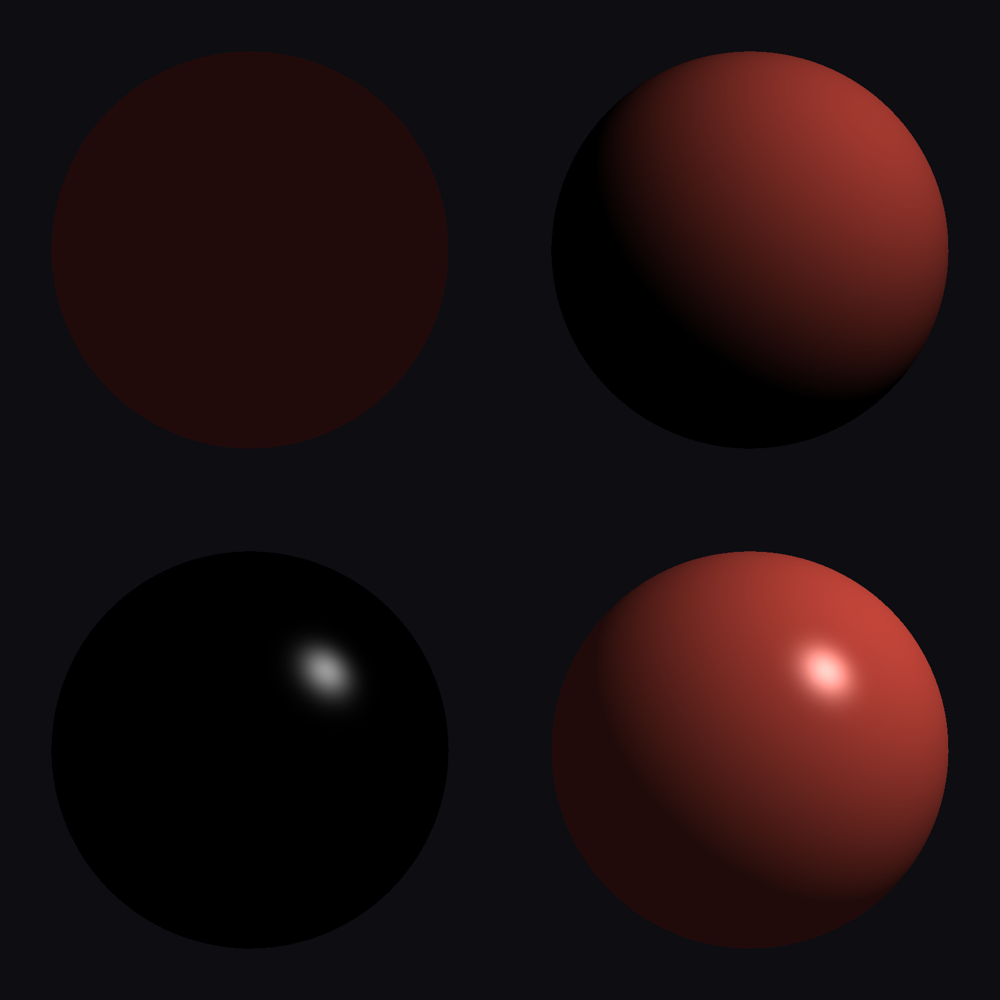
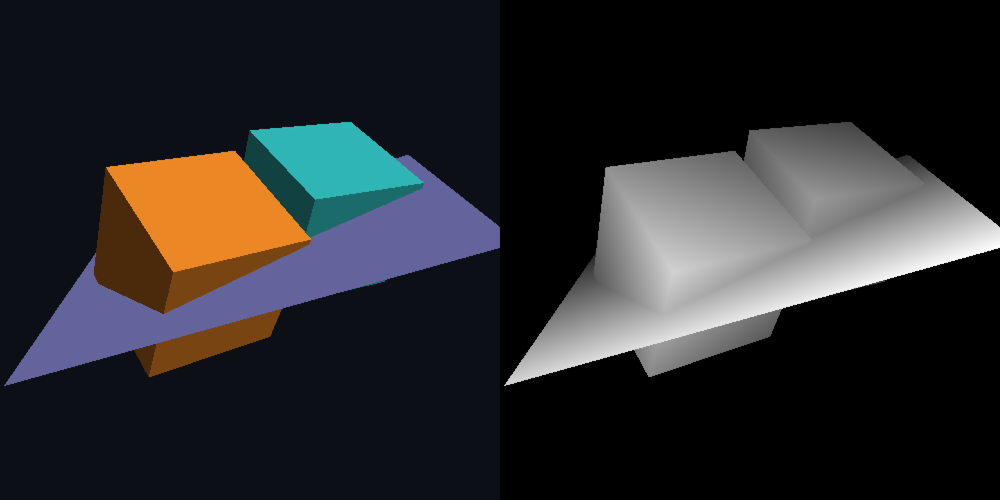

*From raster lines to lit, depth-sorted 3D scenes, with every algorithm written from scratch.*

</div>

---

## 📚 Lab Programs

| # | Lab | Highlights | Folder |
|:-:|---|---|:-:|
| 1 | **DDA & Bresenham line drawing** | Incremental floating-point DDA vs. integer-only Bresenham | [`LAB1`](LAB1) |
| 2 | **Midpoint circle drawing** | Decision parameter `p = 1 − r` with eight-way symmetry | [`LAB2`](LAB2) |
| 3 | **2D transformations** | Translation, rotation, scaling, reflection, shearing as 3×3 homogeneous matrices | [`LAB3`](LAB3) |
| 4 | **Composite transformations** | `M = T · R · S` built by matrix multiplication | [`LAB4`](LAB4) |
| 5 | **Cohen–Sutherland line clipping** | 4-bit outcodes, trivial accept/reject, edge-by-edge clipping | [`LAB5`](LAB5) |
| 6 | **Z-buffer hidden surface removal** | Software scan-converter with a per-pixel depth test, and the depth buffer shown alongside | [`LAB6`](LAB6) |
| 7 | **Phong illumination model** | Ambient + diffuse + specular, evaluated per fragment in GLSL | [`LAB7`](LAB7) |
| 8 | **Vertex & fragment shaders** | VAO/VBO pipeline with interpolated per-vertex colour, plus a Unity project with custom vertex/fragment shaders (vertex-colour triangle and a GPU-displaced, lit wave) | [`LAB8`](LAB8) |
| 9 | **Interactive 3D scene in Unity** | WASD player, follow camera, collectibles and a live score, built entirely from code | [`LAB9`](LAB9) |
| 10 | **3D viewing pipeline** | Model → view → projection → NDC → viewport, perspective vs. orthographic, in OpenGL and in Unity (checked against Unity's own camera matrices) | [`LAB10`](LAB10) |

Each folder has its own `README.md` explaining the algorithm, how to build and run it, and how its screenshots were produced.

---

## 🖼️ Gallery

<table>
  <tr>
    <td align="center" width="50%">
      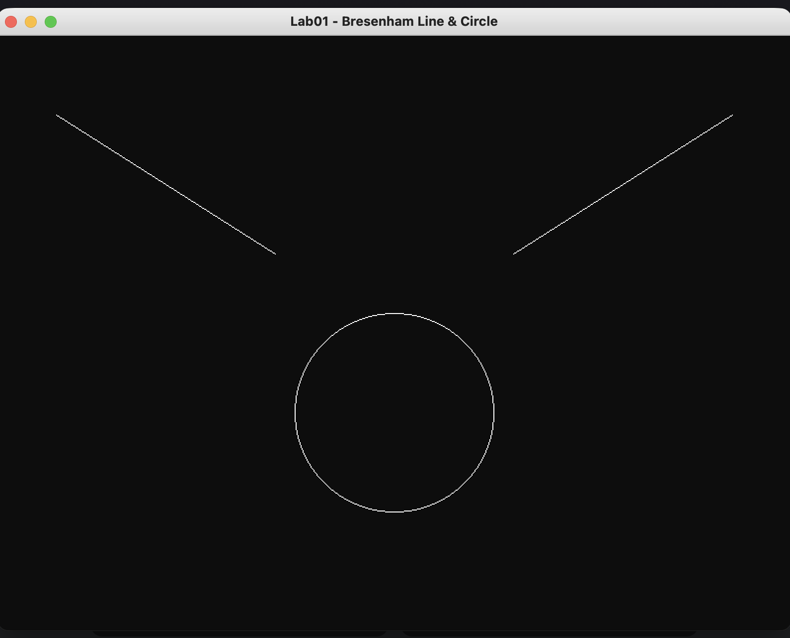<br>
      <b>Lab 1</b> · Bresenham lines & midpoint circle
    </td>
    <td align="center" width="50%">
      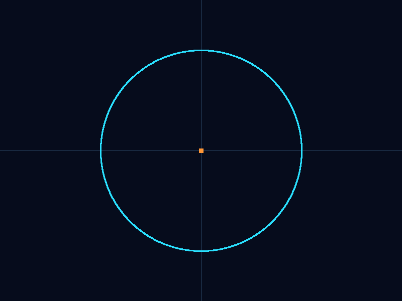<br>
      <b>Lab 2</b> · Midpoint circle algorithm
    </td>
  </tr>
  <tr>
    <td align="center">
      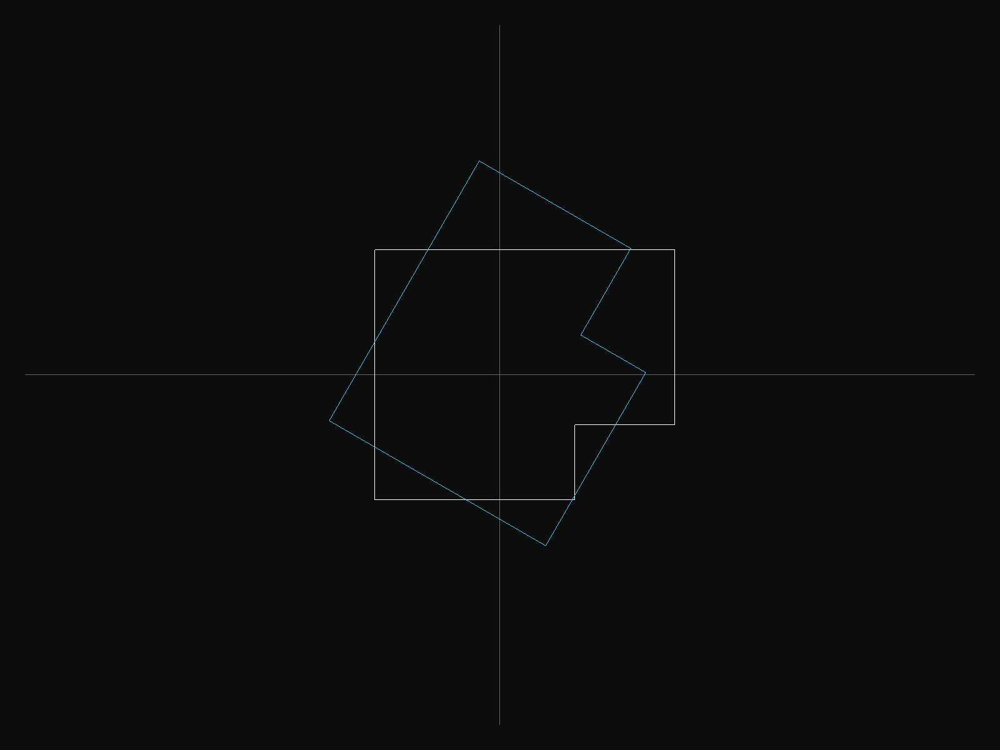<br>
      <b>Lab 3</b> · 2D rotation (homogeneous coordinates)
    </td>
    <td align="center">
      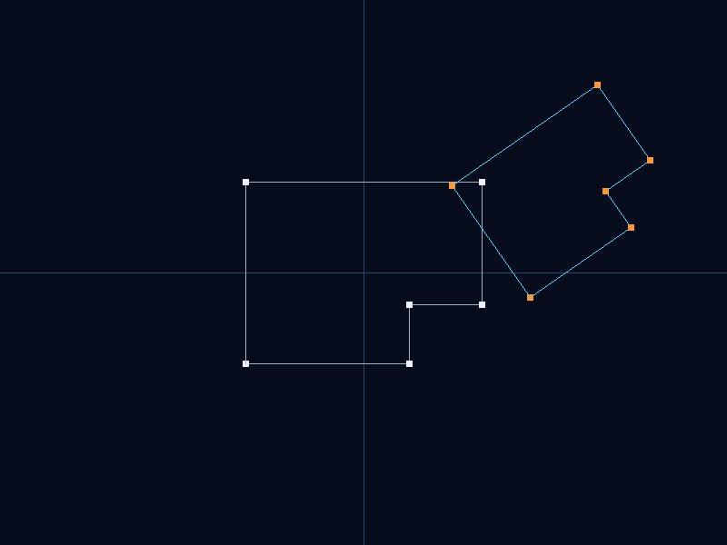<br>
      <b>Lab 4</b> · Composite transformation <code>T·R·S</code>
    </td>
  </tr>
  <tr>
    <td align="center">
      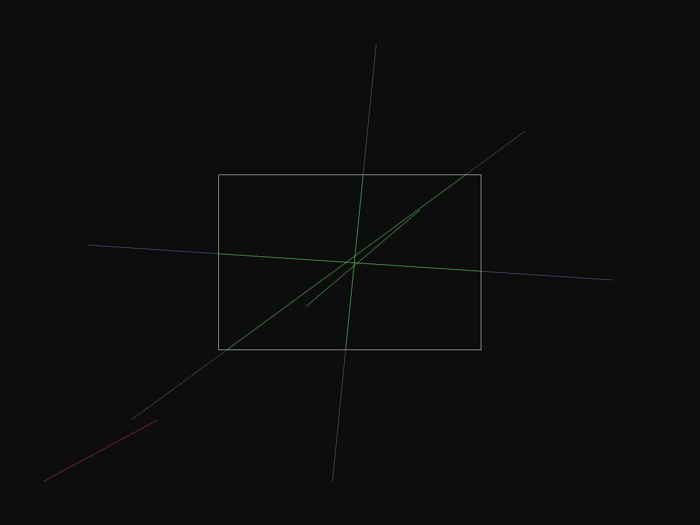<br>
      <b>Lab 5</b> · Cohen–Sutherland line clipping
    </td>
    <td align="center">
      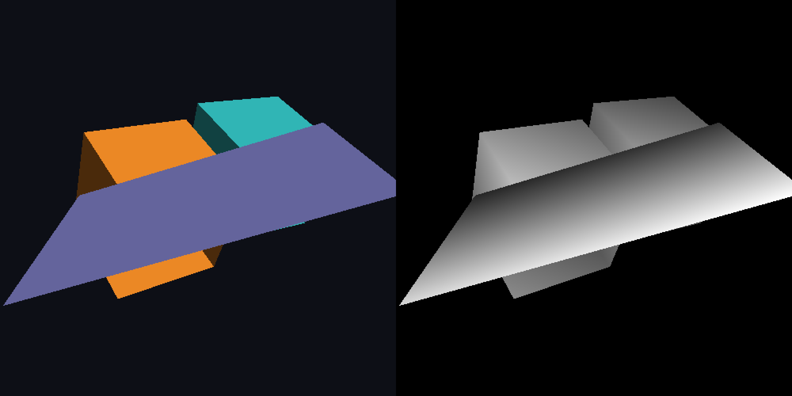<br>
      <b>Lab 6</b> · The same scene <i>without</i> the Z-buffer
    </td>
  </tr>
  <tr>
    <td align="center">
      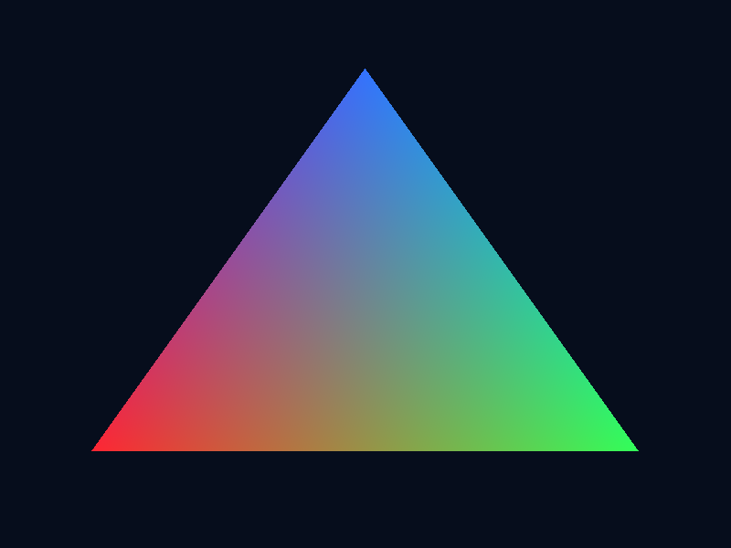<br>
      <b>Lab 8</b> · Vertex & fragment shaders
    </td>
    <td align="center">
      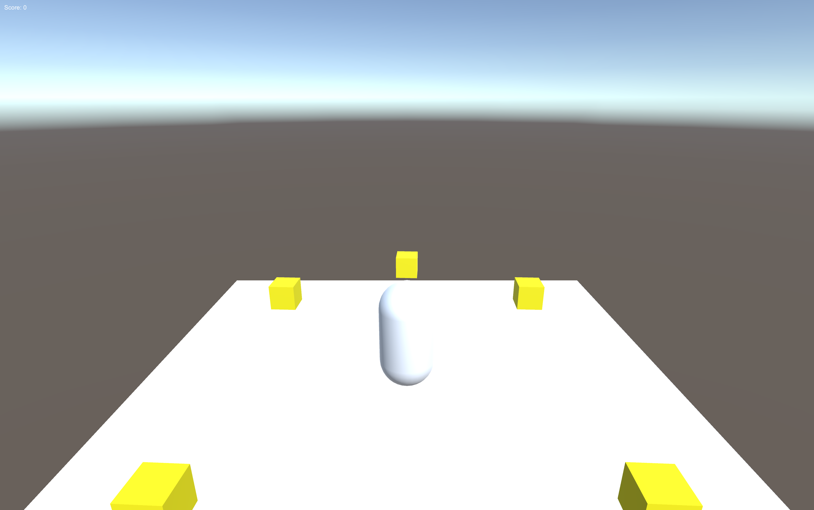<br>
      <b>Lab 9</b> · Interactive Unity scene
    </td>
  </tr>
  <tr>
    <td align="center" colspan="2">
      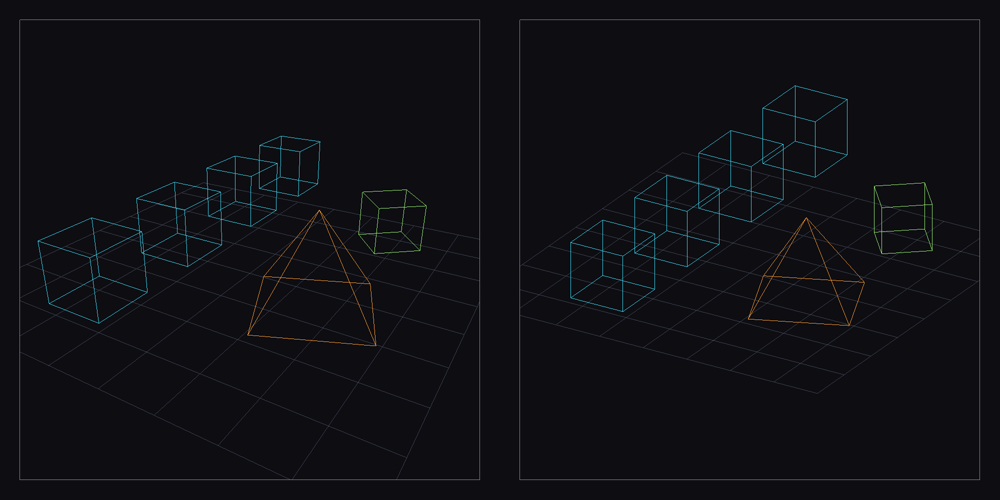<br>
      <b>Lab 10</b> · Perspective (left) vs. orthographic (right) through the full 3D viewing pipeline
    </td>
  </tr>
  <tr>
    <td align="center">
      <br>
      <b>Lab 8 (Unity)</b> · Custom vertex & fragment shaders
    </td>
    <td align="center">
      <br>
      <b>Lab 10 (Unity)</b> · Hand-built viewing pipeline over Unity's render
    </td>
  </tr>
</table>

---

## 🛠️ Getting Started

**Prerequisites (macOS):**

```sh
brew install cmake glfw
```

The OpenGL labs use the bundled GLAD loader in each lab folder (`glad_build/`), so GLFW is the only extra dependency. Lab 9 and the Unity versions of Labs 8 and 10 need **Unity 6** (see [`LAB9/README.md`](LAB9/README.md), [`LAB8/README.md`](LAB8/README.md#unity-version) and [`LAB10/README.md`](LAB10/README.md#unity-version)).

**Build and run any OpenGL lab:**

```sh
cd LAB7
cmake -S . -B build
cmake --build build
./build/phong          # executable name is listed in each lab's README
```

Press <kbd>Esc</kbd> to close a window. Most programs save their screenshot automatically a few frames after launch.

---

## 📁 Repository Layout

```
.
├── LAB1 … LAB10/
│   ├── *.cpp              # lab program(s)
│   ├── CMakeLists.txt
│   ├── README.md          # algorithm notes + build/run steps
│   ├── glad_build/        # OpenGL function loader (where needed)
│   └── screenshots/       # captured output (.png, raw .ppm, text traces)
└── CS4104_Lesson Plan_Final.docx
```

---

<div align="center">

<sub>CS4104 · Computer Graphics and Virtual Reality · School of Computer Science and Engineering, RV University</sub>

</div>
